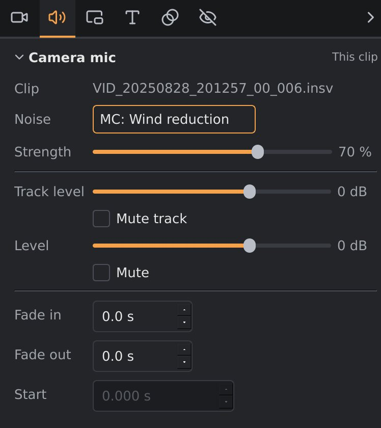
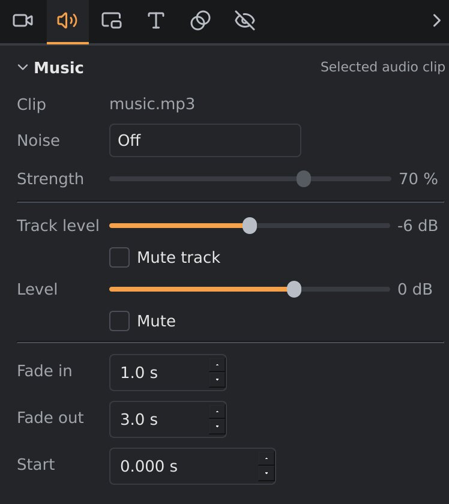

# Audio and noise reduction

This page covers the sound of your video: the camera's own microphones,
music and other audio files, volume and fades, and taking out wind and other
noise. How to add, move, trim and split audio clips on the timeline is in
[The timeline](timeline.md).

## Where the sound comes from

- **The camera's sound.** When you add an `.insv` clip, its sound goes onto
  an audio track right under the video track, called **Camera mic**. It's
  an ordinary audio clip, linked to the video clip: it moves, trims, splits
  and speeds up with it, and is removed with it. The video track itself
  holds only the picture.
- **An external microphone.** If a microphone such as the Insta360 Mic Air
  was connected to the camera, the clip holds a second sound recording. It
  goes onto its own track, **External mic**, under *Camera mic*, linked the same
  way. Both play, each with its own level, mute and noise reduction.
- **Audio files** on the other audio tracks: music, or sound from a
  separate recorder.
- **An overlay's sound.** When you add an overlay video that has sound, its
  sound goes onto a track right under its overlay track, as a clip linked
  to the overlay, the same way as a video clip's.

Everything plays together, in playback and in the export.

## The Audio tab

The settings sidebar's **Audio** tab shows audio clips, one section per
clip, titled with the clip's track. Which clips depends on what's selected,
and each section's title row says which (*This clip*, *Selected overlay
clip* or *Selected audio clip*):

- **A video clip** you selected on the video track, or the clip under the
  playhead if none is selected: all of its sound, one section per track:
  *Camera mic*, and *External mic* if it has one.
- **An overlay clip you selected**: its sound.
- **An audio clip you selected**: click it on an audio track to see just
  that clip. Press `Esc`, or click a clip on the video track, to go back.

With neither, the tab says what to select.

 

*Left: a video clip's sound. Right: a music clip on an audio track.*

Click a section's title to fold it away or open it again; orbis-reframe
remembers this for each kind of track. Each section has:

| Setting | What it does |
|---|---|
| **Clip** | The clip's file name. |
| **Noise** and **Strength** | Noise reduction, see below. |
| **Track level** and **Mute track** | The volume of the whole track the clip is on, on top of each clip's own level, and muting it. |
| **Level** and **Mute** | This clip's own volume, from −24 dB to +12 dB, and muting it. 0 dB leaves it as recorded; negative values make it quieter, positive values louder. |
| **Fade in** / **Fade out** | Fades the clip in from silence at its start, or out to silence at its end, over this many seconds. The fades show as slanted lines over the clip's waveform. At a [transition](transitions.md), a video clip's own sound fades with the picture instead: crossfading with the next clip's, or out and in at a dip to black (where a longer fade of its own wins). |
| **Start** | Where the clip starts on the timeline, in seconds. The arrows move it by 10 milliseconds, for lining up a separate recorder with the picture (see below). Greyed out for a linked clip, which moves with its video. |

The waveform drawn on each clip shows how loud it is, with its level and
fades applied, so you can see the effect of your changes.

To mute the camera's sound of all clips at once, click the **M** box in
the *Camera mic* track's header (or *External mic*'s).

## Two microphones

With an external microphone, each clip has a clip on the *Camera mic* track
and one on the *External mic* track, and the Audio tab shows both. Use
both, for example your voice from the external microphone and the engine
from the camera, or mute the one you don't want: in its section, or with
the **M** box of its track to mute it for every clip.

orbis-reframe tells the two apart by their order in the file, which is how
the X5 records them. If a track ever sounds like the other microphone,
listen to both and use the one you want.

## Projects from earlier versions

A project saved by an earlier version of orbis-reframe is converted when
you open it: each clip's sound goes onto the *Camera mic* and *External
mic* tracks and keeps its level, mute and noise reduction. A recording you
didn't use is muted there, so the project sounds as before. A microphone
you had put on an audio track yourself (**Put the other mic on an audio
track**) moves to its track too, keeping its level and mute; the track it
was on goes if nothing else is left on it. Saving the project saves it in
the new format, which earlier versions can't open.

## Noise reduction

Each audio clip, the camera's sound included, can have one kind of noise
reduction. Pick it under **Noise**, and set how strongly it works with
**Strength**. Picking a mode sets its usual strength.

| Mode | What it does | Use it for | Default strength |
|---|---|---|---|
| **Off** | No noise reduction. | | |
| **Wind reduction** | Turns down wind noise, and keeps voices and other sounds that stand out above it. | Walking, cycling, talking outdoors: wind without an engine. | 70 % |
| **MC: Wind reduction** | For motorcycles. Follows the engine's pitch and keeps its sound, and turns down the rumble around it, wind most of all. Road noise stays. | Riding, with the engine as part of the sound. Works best on a microphone that's sheltered from the wind: it can't dig an engine out of a microphone the wind drowns. | 70 % |
| **Hiss / hum** | Turns down steady background noise (hiss, fans, air conditioning) and mains hum, and keeps voices and anything else that comes and goes. | Quiet scenes, indoors. Not for riding: a steady engine counts as background noise too. | 50 % |
| **Voice only** | Keeps speech and removes everything else: engine, wind, road, music. | Talking to the camera while riding, when only your voice matters. | 100 % |
| **Voice + ambience** | Keeps speech and turns everything else down evenly, so the scene can still be heard. | Talking to the camera, keeping some sound of the ride. | 50 % |

Noise reduction applies to playback and the export. Listen with it on and
off to choose; more strength takes out more noise, but too much can make
what's left sound thin or watery.

**The voice modes** look 3.5 seconds ahead in the sound, so jumping to
another part of the video takes a moment longer while one of them is on.
They need ONNX Runtime (`libonnxruntime1.21` on Debian 13, `libonnxruntime1.23` on Testing and Ubuntu 26.04)
and a speech model that comes with orbis-reframe. If either is missing,
choosing a voice mode says so, and the clip keeps its previous setting.

## Lining up a separate recorder

Sound from a separate recorder (a phone, a voice recorder) doesn't start at
the same moment as the camera, so it has to be lined up by hand:

1. Add the recording to an audio track (**Media ▸ Add audio file…**) and drag
   it roughly into place.
2. Find a sharp sound that both recorded: a clap, a door, a word.
3. Zoom in on the timeline (`Ctrl+` mouse wheel) until you can see that
   sound in both waveforms, and drag the clip until they line up.
4. Select the clip, and fine-tune with the arrows of **Start** in the
   **Audio** tab (10 milliseconds per click) while you listen.

Clapping once in front of the camera at the start of each recording makes
this much easier.
