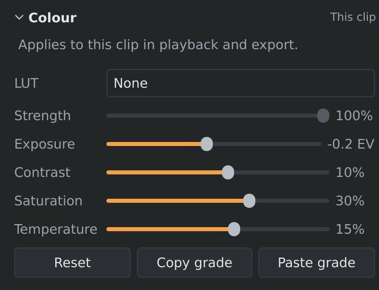
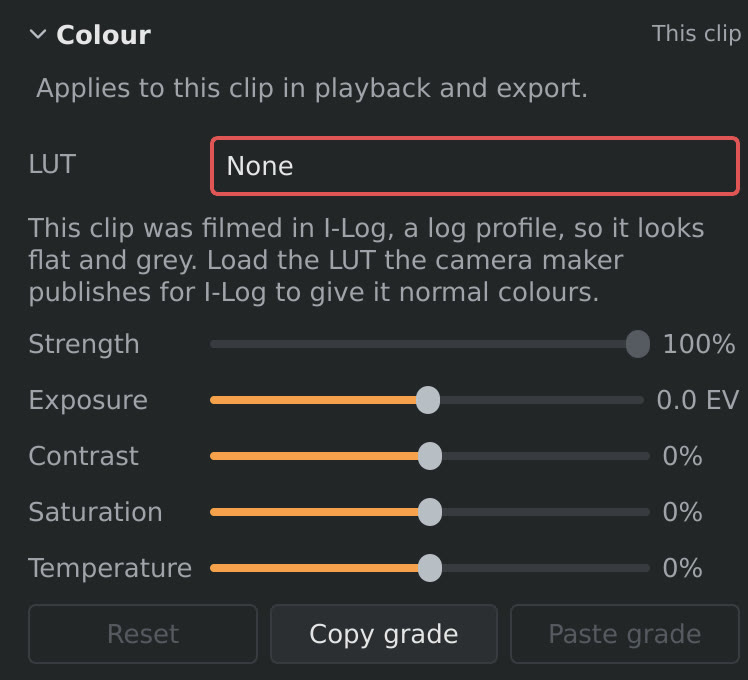

# Colour

The **Colour** section (settings sidebar, **Video** tab) corrects the brightness and colours of a clip: to
brighten a dark clip, make colours richer, or make clips filmed at different
times of day match. It can also apply a LUT, for example the one that turns
footage filmed in a log mode (Insta360's I-Log) into normal colours.

*Right: exposure −0.2 EV, contrast +10 %, saturation +30 %, temperature
+15 %. Warmer and richer colours, with the bright sky kept.*

## The settings

| Setting | What it does | Range |
|---|---|---|
| **LUT** | A colour look-up table (a `.cube` file) applied to the picture before the settings below. **None** applies none. See [LUTs](#luts). | |
| **Strength** | How much of the LUT: 100 % is the LUT's look, 0 % the clip without it. Only with a LUT. | 0 to 100 % |
| **Exposure** | Makes the whole picture brighter or darker, in stops (EV): +1 EV is twice as bright, −1 EV half as bright. | −3 to +3 EV |
| **Contrast** | Positive values make dark parts darker and bright parts brighter; negative values make the picture flatter. | −100 % to +100 % |
| **Saturation** | Positive values make colours stronger; negative values make them paler. −100 % gives black and white. | −100 % to +100 % |
| **Temperature** | Positive values make the picture warmer (more yellow-orange), negative values cooler (more blue). | −100 % to +100 % |

No LUT and all four sliders at 0 leave the picture as filmed. Changes show
in the viewport at once. **Reset** removes the LUT and sets all four back
to 0.

## LUTs

A LUT changes every colour of the picture into another one, by a table in a
file. Camera makers publish one for their log modes: footage filmed in a log
mode looks flat and grey on purpose (it keeps more detail in the bright and
dark parts), and the maker's LUT turns it into normal-looking colours. Other
LUTs give a picture a look (a film stock, a teal-and-orange grade).
orbis-reframe reads 3D LUTs in the `.cube` format, the one camera makers and
most LUT packs use.

To give a clip a LUT:

1. Select the clip and open **Colour** (settings sidebar, **Video** tab).
2. In **LUT**, choose **Load LUT…** and pick the `.cube` file.

orbis-reframe copies the file into the project's `luts/` folder (see
[Projects and export](projects-and-export.md)), so the project keeps working
when the original is moved or deleted. After that, the LUT is in the **LUT**
list for every clip of the project: choose it there, no need to load it again.
A project that hasn't been saved yet uses the file where it is, and copies
it when you save the project. A project file without a folder of its own
(from before project folders) always uses the file where it is.

The LUT is applied first, then **Exposure**, **Contrast**, **Saturation** and
**Temperature** adjust the result. So with log footage, choose the LUT first
and then use the sliders for the fine-tuning.

**Insta360 I-Log.** Insta360 publishes its LUTs on its
[I-Log download page](https://www.insta360.com/download/i-log): one for the X5's 8-bit I-Log and one for the
10-bit I-Log of newer cameras. Use the one for your camera, and only on clips
filmed in I-Log: on normal clips it makes the colours far too strong.

orbis-reframe recognises a clip filmed in a log profile (the camera notes
it in the file; **Media information** shows it as the *Colour profile*). For
now that's Insta360's I-Log. While such a clip has no LUT, the **LUT** field
has a red frame and the section says which profile the LUT is for:

The frame goes away as soon as the clip has a LUT.

If a clip's LUT file is missing or can't be read (for example a project
copied without its `luts/` folder), the clip is shown without it, and the
**Colour** section says why under **LUT**. Load the file again to fix it.

## Which clip it changes

The colour settings belong to one clip on the video track: the clip you
selected, or the clip under the playhead if none is selected (see
[The main window](main-window.md)). Each clip keeps its own settings. When
you split a clip, both halves keep them.

The settings are the same for the whole clip: they don't change over time.
They apply to playback, screenshots and the export. Overlay videos aren't
changed.

## Giving several clips the same look

1. Select the clip whose look you want, and click **Copy grade**.
2. Select another clip, and click **Paste grade**. It gets the LUT, its
   strength and all four settings.

The same is on the timeline: right-click a clip for **Copy colour grade**,
**Paste colour grade**, and **Paste colour grade to all clips**, which gives
every clip on the video track the copied look.

The copied grade is kept until you close orbis-reframe, so you can paste it
as often as you like. **Edit ▸ Undo** (`Ctrl+Z`) takes back a paste or a
Reset; pasting to all clips is undone in one step.

## Tips

- **Watch the sky.** 360° footage nearly always has bright sky in it. Raising
  the exposure or the contrast can turn it plain white, and the detail can't
  be brought back. Look at a frame with a lot of sky while you set them.
- **Small steps.** Small changes (a few tenths of a stop, 10 to 30 %) usually
  look natural. To compare with the original, click **Reset**, then
  **Edit ▸ Undo** (`Ctrl+Z`) to get your settings back.
- **Make clips match.** If one clip is darker or bluer than the one before
  it, put the playhead on the cut, and adjust the second clip until the two
  sides of the cut look alike.
