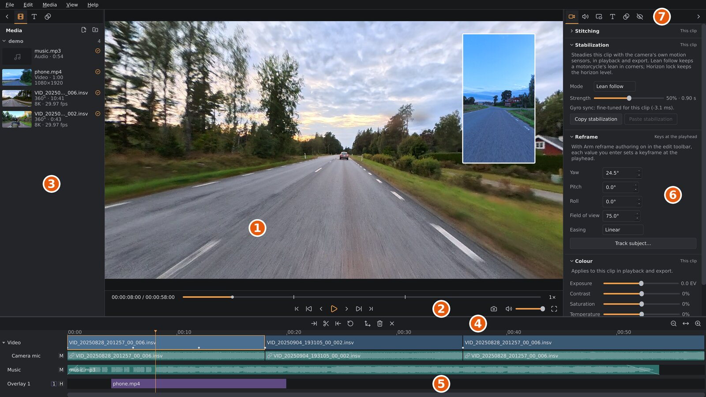

# The main window

This page is a tour of orbis-reframe's window: what each part is called,
what it's for, and which chapter covers it in detail. The later chapters use
the names from here.

Without a project open, the window shows the **project library**, your
projects as cards; see [Projects and export](projects-and-export.md#the-project-library).
With one open, it looks like this:

1. The **viewport**: the picture.
2. The **player bar**, for watching: play, step, jump, the progress bar,
   speed, volume and full screen; see [The player bar](#the-player-bar).
3. The **media sidebar**, with the project's media and the titles; see
   [The media sidebar](#the-media-sidebar).
4. The **edit toolbar**: trim, split and keyframe buttons, and the
   timeline's zoom.
5. The **timeline**: your clips, overlays and audio, in time order.
6. The **settings sidebar**, here on its **Video** tab.
7. The settings sidebar's **tabs**.

The title bar shows the project's file name, or *untitled* for a project
that hasn't been saved yet. A `*` after the name means there are unsaved
changes.

## The viewport

The viewport shows the video as your export will look: a flat picture cut
out of the 360° sphere. Its shape follows the project's aspect ratio
(16:9, 9:16, 1:1 or 4:3, set in **File ▸ Project settings…**), so what you frame
here is what you get.

| To | Do |
|---|---|
| Look around | Drag with the left mouse button. |
| Zoom in or out (narrower or wider view) | Turn the mouse wheel. |
| Move an overlay (picture-in-picture) | Drag it. The pointer changes to a four-way arrow over one. |
| Remove a privacy blur | Right-click it. See [Privacy blur](privacy.md). |

Looking around only changes what you see right now. To make the export
follow a view, you set **reframe keyframes**, covered in
[Reframing](reframing.md).

## The media sidebar

The sidebar on the left of the viewport holds what you put on the
timeline, on three tabs: **Media** (),
the files you work with, **Titles** (),
text to put over the video (see [Titles](titles.md)), and **Transitions**
(), to go
over from one clip to the next at a cut (see [Transitions](transitions.md)). The icons along its
top pick the tab. The `<` button at its top-left closes the
sidebar and leaves a slim strip at the window's edge; the `>` button on the
strip opens it again. `Ctrl+B` does both. To make it wider or narrower,
for example to read long file names, drag its right edge (the pointer
becomes a two-way arrow there); double-click the edge to go back to the
default width. orbis-reframe remembers whether it was open and how wide.

**Media** lists the project's media: every file you've imported, and every
file used on the timeline. The files stay where they are on your disk; the
project only remembers where they are. The list is grouped by the folder
each file is in, and sorted by name. Each file shows a small picture, its
name, its kind (*360°*, *Video* or *Audio*) and length, and its resolution
and frame rate. An orange check mark in a circle, to the right of the name, means the file is used on the timeline. A file that can't be
found any more is shown in red with *File not found*; this follows the disk
while the app runs, so a file that's put back, or a drive that's plugged in
again, turns normal again by itself. Click a folder's name
to fold it away.

| To | Do |
|---|---|
| Add files | **Media ▸ Import files…** (`Ctrl+I`), the first button at the top of the tab (), or drag files from your file manager onto the list. |
| Add everything in a folder | **Media ▸ Import folder…**, the second button (), or drag the folder onto the list. Every video and audio file directly in it is added (not its subfolders). |
| Put a file on the timeline | Drag it onto the timeline, or double-click it. A 360° clip goes onto the video track, a video onto an overlay track, an audio file onto an audio track; see [The timeline](timeline.md). You can select several files and drag them together. |
| Remove a file from the project | Right-click it and choose **Remove from project**, or press `Delete`. The file itself isn't deleted. A file used on the timeline can't be removed. |
| Find a file on disk | Right-click it and choose **Show in file manager**. |
| Find a moved or renamed file | Double-click it (it's red, *File not found*), or right-click it and choose **Locate file…**, and pick where it is now. See [Projects and export](projects-and-export.md#where-the-clips-are). |

Importing is part of the project, so **Edit ▸ Undo** takes it back like any
other edit. The `.lrv` preview files the camera writes next to each `.insv`
aren't listed.

## The timeline

Under the viewport and both sidebars, across the whole width of the window,
is the timeline: your edit, from left to right in time. To give it more or
less room, drag the line between it and the viewport up or down;
orbis-reframe remembers the height. Until you do, the timeline is as tall
as its tracks need. When the tracks don't fit, scroll them up and down with
the mouse wheel over the track names, `Shift` + the mouse wheel anywhere
on the timeline, or the scroll bar at its right edge; the ruler stays in
place.

From top to bottom it has:

- the **ruler**, with the time. Click or drag on it to move the **playhead**,
  the vertical line that marks the frame shown in the viewport;
- the **video track**: your `.insv` clips, one after another, with a hard
  cut between each pair;
- the video clips' sound, on the **Camera mic** track (and **External mic**,
  when an external microphone was connected);
- any other **audio tracks**: music, or sound from an external recorder;
- any **overlay tracks**: videos shown as picture-in-picture over the 360°
  video, each with its sound on a track right under it.

A little space separates these three groups: the video and its sound, the
audio tracks, the overlays. A click on the **Video** track's header folds
its sound tracks away and brings them back; an overlay track has a
triangle for its audio track.

Clicking a clip selects it. It doesn't move the playhead: only the ruler
and the player bar's progress bar do that. [The timeline](timeline.md) explains how to arrange, trim, split and
speed up clips.

## The player bar

The bar directly under the viewport is for watching. It has two rows.

**On top**, from left to right:

- **The time**: where the playhead is, and the length of the timeline, as
  hours:minutes:seconds:frames (`00:01:23:14` is 1 minute, 23 seconds and
  14 frames), counted at the project's frame rate. Click it (or press
  `Ctrl+G`) to type a time and press `Enter` to jump there: as shown, or
  shorter -- `1:23` is 1 minute 23 seconds, `83.5` is 83½ seconds. `Esc`
  gives up.
- **The progress bar**: the whole timeline from start to end, however far
  the timeline below is zoomed in. Click it to jump, or drag along it to
  scrub, just like the ruler. The small ticks are the cuts between clips.
  Hover over it to see the time under the pointer.
- **The speed**: `1×` normally. Click it to play slower or faster, from
  `0.25×` to `2×`, or press `J` (slower) and `L` (faster; `L` also starts
  playback). It's only for watching -- the export is never affected (to
  speed up a clip in the video, see [The timeline](timeline.md)). The sound
  plays at `1×` only; at any other speed the preview is silent. At `2×` a
  computer that only just plays the clip in real time may skip frames.

**Below**, in the middle, the playback buttons, each doing what its key
does:

| Button | What it does |
|---|---|
|   To start / to end | To the start / end of the timeline (`Home` / `End`). |
|   Previous / next cut | To the previous / next cut or clip edge (`↑` / `↓`). |
|   One frame back / forward | Steps one frame and pauses (`←` / `→`). Hold the button to keep stepping. |
|  Play / pause | Starts or stops playback (`Space`). |

On the left, *Buffering…* shows while the video loads. On the right:

| Button | What it does |
|---|---|
|  Screenshot | Saves the frame the viewport shows (the frame at the playhead) as a PNG (`Ctrl+Shift+P`); see [Screenshots](projects-and-export.md#screenshots). |
|  Volume and mute | How loud the preview plays, and the speaker button to mute it. Only what you hear while editing: the export and the clips' own volume (the **Audio** tab) don't change. orbis-reframe remembers the volume for the next time. |
|  Full screen | Shows only the picture and the player bar, over the whole screen (`F11`, or double-click the picture). The player bar hides when the mouse rests and comes back when you move it. `Esc` or `F11` leaves full screen. |

Hover over a button to see its name and shortcut.

## The edit toolbar

The strip directly above the timeline holds the editing tools that act at
the playhead, in the middle of the window. From left to right:

| Button | What it does |
|---|---|
|  Set trim in | Cuts the start of a clip off at the playhead (`[`). |
|  Split | Cuts the clip in two at the playhead (`S`): the selected audio or overlay clip, otherwise the video clip. |
|  Set trim out | Cuts the end of a clip off at the playhead (`]`). |
|  Restore | Gives the clip back its full length (`R`). |
|  Arm reframe authoring | While on, every drag or zoom in the viewport sets a reframe keyframe at the playhead (`A`). |
|  Delete keyframe | Deletes the reframe keyframe at the playhead (`Shift+K`). |
|  Delete all keyframes | Deletes every reframe keyframe of the clip under the playhead (`Ctrl+Shift+K`). |

At its right end are the timeline's zoom buttons:

| Button | What it does |
|---|---|
|  Zoom out | Shows more of the timeline (`Ctrl+-`). |
|  Zoom to fit | Shows the whole edit across the timeline (`Ctrl+0`). |
|  Zoom in | Shows less of the timeline, in more detail (`Ctrl++`). |

Hover over a button to see its name and shortcut.

Left of the zoom buttons, short messages appear: what the program is
doing, or why something you tried didn't work (for example *"Move the
playhead into the selected clip to trim it"*). Hover over a message that
doesn't fit to read all of it.

## The settings sidebar

The sidebar on the right of the viewport holds the settings, sorted by
subject into six tabs. The icons along its top pick the tab; hover over one
to see its name. `Alt+1` to `Alt+6` pick the tabs from left to right; the
key of the tab that's already showing closes the sidebar.

| Tab | What it sets |
|---|---|
|  **Video** | Everything about the picture, in the order you'd usually work: **Stitching** (how the camera's two lenses are joined into one picture), **Stabilization** (smoothing out camera shake, keeping the horizon level), **Reframe** (the view: angles and field of view, keyframes and their easing, and **Track subject**, which follows a person or vehicle automatically), **Colour** (exposure, contrast, saturation and other colour corrections) and **Media information** (details of the clip's file, read only; see [Media information](media-information.md)). |
|  **Audio** | A section per audio clip: the selected one, or all of a video or overlay clip's sound (*Camera mic*, *External mic*). Noise and wind reduction, its volume and its track's, fades. See [Audio and noise reduction](audio.md). |
|  **Overlay** | Size, position and look of the selected picture-in-picture clip. |
|  **Title** | The selected title's text, font and colour, and its position, size and timing. See [Titles](titles.md). |
|  **Transition** | The selected transition's length. See [Transitions](transitions.md). |
|  **Privacy** | Blurring number plates. |

Each tab is made of **sections**, such as **Stabilization** or **Colour**.
Click a section's title to fold it away to just its title row, and again to
open it. **Stitching** and **Media information** start folded, since you
rarely need them. orbis-reframe remembers which sections you've opened or
folded. When a tab's sections don't fit in the window, the tab scrolls.

Like the left sidebar, the `>` button at the top-right closes the settings
sidebar and leaves a slim strip at the window's edge, whose `<` button opens
it again; `Ctrl+Shift+B` does both. Drag its left edge to make it wider or
narrower; double-click the edge to go back to the default width.
orbis-reframe remembers whether it was open, how wide, and which tab was
showing.

**Which clip a section changes.** The right end of each section's title row
says what the section applies to:

| It says | Meaning |
|---|---|
| *This clip* | The selected video clip if you've clicked one, otherwise the clip under the playhead. Stitching (shared by every clip of the same file), Stabilization, Colour, Privacy, Audio (the clip's sound) and Media information. |
| *Selected audio clip* | The **Audio** tab's sections, when you've selected an audio clip on an audio track. |
| *Selected overlay clip* | The **Overlay** section, and the **Audio** tab's sections for its sound: the overlay you've selected. |
| *Keys at the playhead* | The **Reframe** section: the view at the playhead, and the keyframe there. |

The project's output format (aspect ratio, resolution and frame rate) isn't
in the sidebar: it's in **File ▸ Project settings…**, see
[Projects and export](projects-and-export.md#project-settings).

## Menus

| Menu | Contains |
|---|---|
| **File** | New project, open project, back to the project library; save, save as; **Project settings…** (the output format); export, quit. (Screenshots are in the player bar.) |
| **Edit** | **Undo** (`Ctrl+Z`) and **Redo** (`Ctrl+Shift+Z`). Undo steps back through your edits to the project; looking around in the viewport isn't an edit and isn't undone. |
| **Media** | **Import files…** (`Ctrl+I`) and **Import folder…**, into the project's media ([above](#the-media-sidebar)); **Add clip to timeline…** (`Ctrl+Shift+A`), **Add audio file…** (`Ctrl+Shift+M`) and **Add video overlay…** (`Ctrl+Shift+V`), straight onto the timeline; **Add audio track** and **Add overlay track**. |
| **View** | **Preview quality** and **Preview size**: how the preview in the viewport is stitched. They change only what you see while editing, never the export; see [Stitching](stitching.md#preview-size-and-quality). **Theme**: the app's colours -- **Ember** (dark grey with an orange accent, the default), **Light**, or **Neutral dark** (dark grey with a blue accent). It changes at once and is remembered; the area around the picture stays dark in every theme, so the picture's brightness is judged the same way. |
| **Help** | **User manual** opens this manual in your web browser, on GitHub: for a release, the copy that matches your version. **Keyboard shortcuts** (`F1`), and **About orbis-reframe**, with the version and the diagnostics to include in a problem report. |

When you close the window, open another project or go back to the project
library with unsaved changes,
orbis-reframe asks whether to save them first: **Save** (`S` or `Enter`),
**Discard** (`D`) or **Cancel** (`Esc`).
