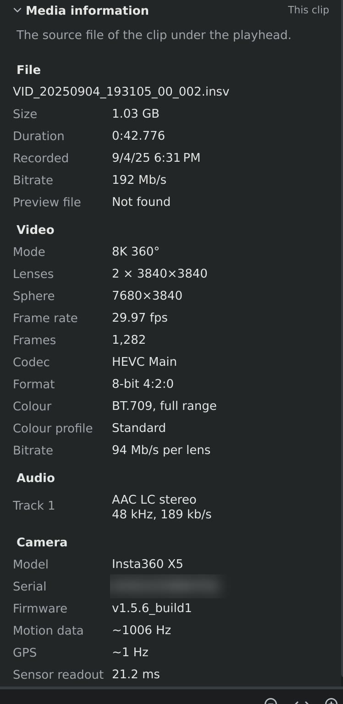

# Media information

The **Media information** section, at the bottom of the settings sidebar's
**Video** tab, shows what's inside a clip's `.insv` file: how it was
recorded, by which camera, and in what format. It starts folded: click its
title to open it. It only shows information; nothing here can be changed.

It shows the file of the clip you selected on the video track, or of the
clip under the playhead if none is selected. With no clip, it's empty.

*An 8K clip recorded on an X5. The camera's serial number is blurred here.*

Hover over a value to see more about it, where there is more: the file's
full path, or what a value means.

## File

| Row | What it shows |
|---|---|
| (file name) | The name of the `.insv` file. Hover over it for the full path. |
| **Size** | The file's size on disk. |
| **Duration** | How long the whole recording is, in minutes, seconds and thousandths, before any trimming. |
| **Recorded** | When the recording was made, by the camera's clock, in your computer's time zone. |
| **Bitrate** | How much data the file holds per second of video, sound included. Higher means more detail, and larger files. |
| **Preview file** | Whether the camera's low-resolution preview file (`.lrv`) is next to the `.insv`. orbis-reframe doesn't need it, so *Not found* is fine. |

## Video

| Row | What it shows |
|---|---|
| **Mode** | The X5's recording mode: **8K**, **5.7K** or **4K** 360°. Read from the size of the lens pictures. 5.7K+ records pictures the same size as 5.7K, so it shows as 5.7K. |
| **Lenses** | The size of each of the two fisheye pictures, in pixels. |
| **Sphere** | The size of the whole 360° picture once the two are stitched together, as a flat world-map image. |
| **Frame rate** | Frames per second, such as 29.97, 59.94 or 119.88. |
| **Frames** | How many frames the recording has. |
| **Codec** | How the video is compressed: **HEVC** (H.265) or **H.264**, with its profile. |
| **Format** | Bits per colour (8 or 10) and how the colour is stored (4:2:0). |
| **Colour** | The colour standard (BT.709) and whether the levels use the full or the limited range. |
| **Colour profile** | The colour profile the camera filmed in: **Standard**, or a log profile such as **I-Log** (Insta360's). A log clip looks flat and grey until you give it the LUT the camera maker publishes for that profile (see [LUTs](colour.md#luts)). Shown when the camera writes it into the file. |
| **Bitrate** | The video's data rate, for each of the two lens pictures. |

## Audio

One row for each sound recording in the file: **Track 1**, and **Track 2**
for a clip with an external microphone (on the timeline, the *External mic*
and *Camera mic* tracks; see [Audio and noise reduction](audio.md)). Each row shows the
format (usually AAC), the channels (mono or stereo), the sample rate and
the data rate.

## Camera

| Row | What it shows |
|---|---|
| **Model** | The camera that recorded the file, such as *Insta360 X5*. |
| **Serial** | The camera's serial number. Blur it out if you share a screenshot of this section. |
| **Firmware** | The camera's software version at the time of recording. |
| **Motion data** | How often the camera recorded its movement, which [stabilization](stabilization.md) works from: about 1000 times a second on the X5. *Not recorded* means stabilization can't work for this clip. |
| **GPS** | Whether a GPS source, such as Insta360's GPS remote, recorded where you were: how often the position was updated (about once a second), or *Not recorded*. A second line says when the track covers only part of the recording, for example because the signal was lost, or *no position fix* if the GPS never found its position. The positions themselves aren't shown, so a screenshot of the section doesn't give away where you rode. |
| **Sensor readout** | How long the camera's sensor takes to read one picture from top to bottom (the rolling shutter). orbis-reframe uses it to straighten the picture during fast movement. |

## When it's useful

- **Checking a clip before editing:** the mode, frame rate and length, for
  example to find the 120 fps clips for slow motion.
- **Reporting a problem:** the mode, codec and firmware help pin down a bug.
  The diagnostics in **Help ▸ About orbis-reframe** describe your computer;
  this section describes the clip.
- **If a clip won't open:** the section shows **Error** with the reason, such
  as *file not found*.
