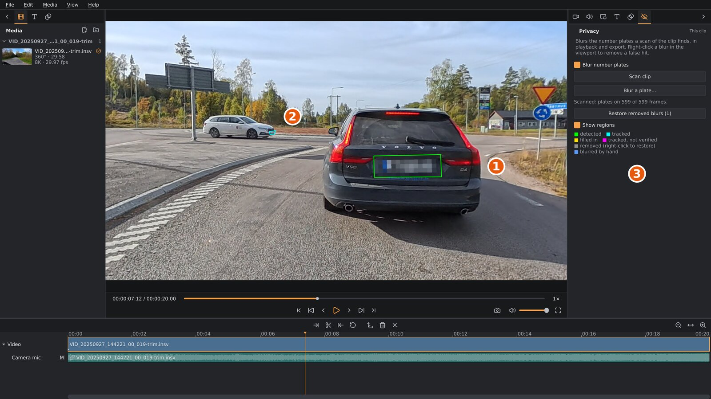

# Privacy blur

In many countries you should hide other people's number plates before you
publish a video. A 360° video sees every car around you, so orbis-reframe
can find the plates for you and cover them with a mosaic.

orbis-reframe blurs **number plates** only. It doesn't blur faces.

> **Demo video:** [plate blur and stabilization on a motorcycle ride](https://youtu.be/BER8GgtOpjQ)
> (YouTube, 3:41). Recorded in October 2026, so the window may look a little
> different in your version.

1. A plate the scan found, blurred, and outlined because **Show regions** is
   on. Green means the scan detected it in this frame.
2. A plate further away, outlined in cyan: the scan followed it from frames
   where it was detected.
3. The settings sidebar's **Privacy** tab, with the colour key for the outlines.

## Blurring the plates in a clip

The privacy blur is set for each clip on the video track: the clip you
selected, or the clip under the playhead.

1. Open the settings sidebar's **Privacy** tab and tick **Blur number plates**.
2. Click **Scan clip**. orbis-reframe looks for plates in the whole clip
   (its trimmed part, and the footage past it that a
   [crossfade](transitions.md) shows), a little faster than the clip plays. The tab shows
   how far it has come. **Stop scan** stops it and keeps the part scanned.
3. When the scan is done, the tab says on how many frames it found
   plates, and every plate it found is blurred, in playback, screenshots and
   the export.
4. Check the result: play the clip, ideally with **Show regions** on (see
   below), and fix what the scan got wrong.

The scan result belongs to the clip and isn't lost when you close the
project. Other clips cut from the same file have their own scans, so each
can be scanned with its own settings (stabilization on in one, off in
another). A clip you duplicate or split after scanning keeps the scan in
both copies, until one of them is scanned again. **Undo** after a scan
brings back the clip's scan from before; scans no clip (nor undo) can
reach any more are removed when you save. Scans are stored in the project's
`cache/` folder (in `~/.cache/orbis-reframe/` for an untitled project or
one from before project folders); **Save project as…** copies them to the
new folder. If you delete the cache folder, scan again.

> **No export without a scan.** While **Blur number plates** is on, a clip
> must be scanned over its whole trimmed length. If it isn't, the export and
> screenshots are refused with a message saying which clip still needs
> scanning. This stops you from publishing a video you think is blurred
> but isn't. If you lengthen a clip's trim after scanning, the tab says
> *Partly scanned*: scan it again.

## Checking the scan: Show regions

Tick **Show regions** to outline everything the scan found, in colours that
say how each plate was found:

| Colour | Meaning |
|---|---|
| Green | **Detected**: found in this frame. |
| Cyan | **Tracked**: followed from a frame where it was detected. |
| Yellow | **Filled in**: a short gap between two sightings, bridged. |
| Magenta | **Tracked, not verified**: followed, but not confirmed. Check these. |
| Grey | **Removed** by you (see below). Right-click to bring it back. |
| Blue | **Blurred by hand** (see below). |

The outlines show whether the blur is on or not, and are never exported.

## Removing a wrong blur

Sometimes the scan blurs something that isn't a plate, such as a road sign
or a sticker. Right-click the blur in the viewport:

- **Remove this blur** drops it in every frame it appears in.
- **Remove this blur from here on** keeps it before the playhead and drops
  it from there.

To bring a removed blur back, turn on **Show regions**, right-click its grey
outline and choose **Restore this blur**. **Restore removed blurs** in the
tab brings back all of them at once. **Edit ▸ Undo** works too.

## Blurring a plate the scan missed

If the scan missed a plate, blur it by hand:

1. Move the playhead to a frame where the plate is clearly visible.
2. Click **Blur a plate…** in the **Privacy** tab, or press `B`. Playback
   pauses.
3. Drag a box around the plate in the viewport (`Esc` cancels).
4. orbis-reframe follows the plate forwards from that frame, then backwards
   from it, and blurs it for as long as it can follow it. The tab shows
   how far it has come. **Stop following** stops it.

The tab counts the plates blurred by hand. A hand-blurred plate is
blurred even without a scan, and even with **Blur number plates** off. To
remove one, right-click it in the viewport: **Remove this blur**, or
**Remove this blur from here on**.

If the plate goes out of sight and comes back, the blur may stop where it
was lost. Blur it again from a frame after it reappears.

## Stabilization and the blur

The scan and the hand-blurred plates fit the picture as it was stitched at
the time. With stabilization on, the picture is stitched slightly
differently (see [Stabilization](stabilization.md)). If you turn the
clip's stabilization on or off afterwards, the blurs may sit a little off
the plates when the camera swings fast.

orbis-reframe notices this. The **Privacy** tab shows a warning, and an
export or screenshot asks before going ahead. Check the blurs with **Show
regions**, or scan again and blur the hand-blurred plates again, or set the
stabilization back to how it was.

## If the buttons are greyed out

On a flat video on the video track, the tab says the blur works on 360°
clips only for now, and has no buttons.

A note in the tab says why: the plate model is missing from the
installation (install orbis-reframe again). **Scan clip** and **Blur a
plate…** are also greyed out while a scan is running or a plate is being
followed.

## Before you publish

The scan finds most plates, not all of them. Small, far away, dirty,
angled or fast-moving plates can be missed, especially in the short moments
when they come into view. Before you publish, play the exported video
through and look for plates that are still readable. Blur any you find by
hand, or reframe so they're out of the picture.
