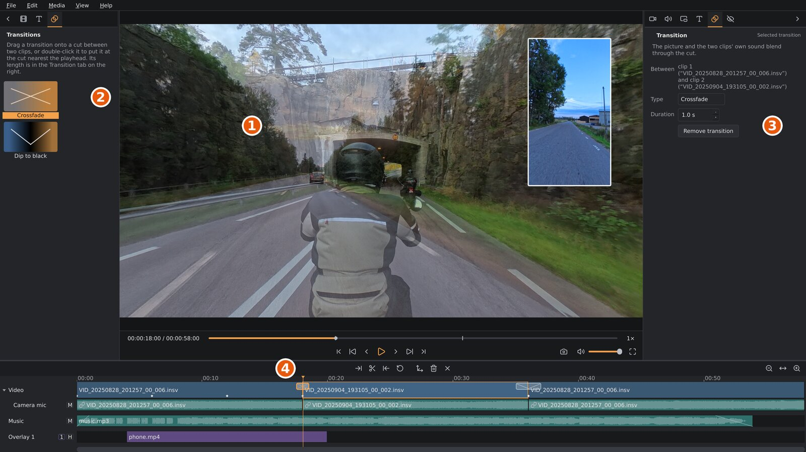

# Transitions

At a cut, one clip normally gives way to the next at once. A transition
makes the change gradual. There are two kinds:

- **Crossfade**: the two clips blend: for a moment both show, the first
  fading out as the second fades in.
- **Dip to black**: the first clip fades out to black, then the second
  fades in from black.

1. The picture halfway through a crossfade: both clips at once.
2. The media sidebar's **Transitions** tab.
3. The settings sidebar's **Transition** tab, with the selected
   transition's settings.
4. The crossfade on its cut: a box as long as the blend, crossed. The
   dip to black on the next cut has a V instead.

## Adding a transition

Open the media sidebar's **Transitions** tab
(), then:

- drag **Crossfade** or **Dip to black** onto the video track: it goes
  on the cut nearest to where you drop it; or
- double-click it (or select it and press `Enter`, or right-click it and
  choose **Add at the nearest cut**) to put it on the cut nearest the
  playhead.

A transition needs a cut, so there must be two clips on the video track
at least. A cut has one transition: putting another on it changes its
kind and keeps its length. A new transition lasts 1 second. It is selected, and the settings
sidebar shows its **Transition** tab
().

## How it works: footage past the cut

A transition is centred on the cut, and the clips stay where they are: the
timeline doesn't get any shorter.

A dip to black needs nothing more: the first clip fades out over the half
before the cut, the second fades in over the half after it, each within
what you kept of it. It works on any cut.

A crossfade shows both clips at once, so it needs more of them. A 1-second crossfade plays the first clip on for half a second
past its end, and starts the second clip half a second before its start.
That footage comes from what you trimmed off.

So a crossfade works best between clips you have trimmed at the cut. If
there's less footage than that past the cut, the crossfade is shorter; if
there's none, for example at the very end of a recording, it doesn't play
at all and the cut stays hard. Its box on the timeline is then small and
marked with **!**, and its tooltip and the Transition tab say why. They
name the clip by its place on the video track as well as its file (clip 1
is the first), since clips cut from one recording share a file name. Trim
that clip shorter at the cut to make room. Either kind is also never longer than its clips allow: at most half of
the shorter one, so the transitions at a clip's two ends never meet.

On a clip with a different speed, the footage it uses is at that speed too.

## Settings

Click a transition's box on the timeline to select it. The settings
sidebar's **Transition** tab then shows:

| Setting | What it does |
|---|---|
| **Between** | The two clips it joins. |
| **Type** | The kind of transition: **Crossfade** or **Dip to black**. Changing it keeps the duration. |
| **Duration** | How long it takes, centred on the cut: 0.1 to 10 seconds. If there isn't enough footage past the cut for all of a crossfade, or a clip is too short, a line under it says how long it plays. |
| **Remove transition** | Back to a hard cut. `Delete` does the same, as does **Remove transition** in the box's right-click menu. |

## What changes

- **The picture.** Each clip looks as it does on its own: its own reframe
  view, stabilization, colour grade, stitching and privacy blur. In a
  crossfade, the first clip's view past its end is where its last reframe
  keyframe looks. Overlays and titles stay on top: a dip to black doesn't
  darken them.
- **The clips' own sound.** In a crossfade the first clip's sound fades
  out while the second clip's fades in, over the whole transition. In a
  dip to black it follows the picture: the first fades out up to the cut,
  the second fades in after it. Music and other audio on their own tracks
  isn't changed.

Transitions show in playback, screenshots and the export alike. While
playing, a crossfade between two 360° clips decodes both at once, which
asks more of the graphics card than a single clip.

## Transitions and edits

A transition belongs to its cut:

- Trimming a clip at the cut changes how much footage there is past it,
  and with it how long a crossfade plays.
- Splitting or duplicating the clip before the cut keeps the transition on
  the same cut.
- Moving a clip away from the cut, putting another clip into it, or
  removing either clip removes the transition.

Undo brings it back like any other edit.

## Privacy blur

With **Blur number plates** on, the footage a crossfade shows past the
trims has to be scanned too (a dip to black shows none). **Scan clip** in the Privacy tab covers it;
if you add or lengthen a crossfade after scanning, scan the clip again,
or the export refuses it (see [Privacy blur](privacy.md)).
